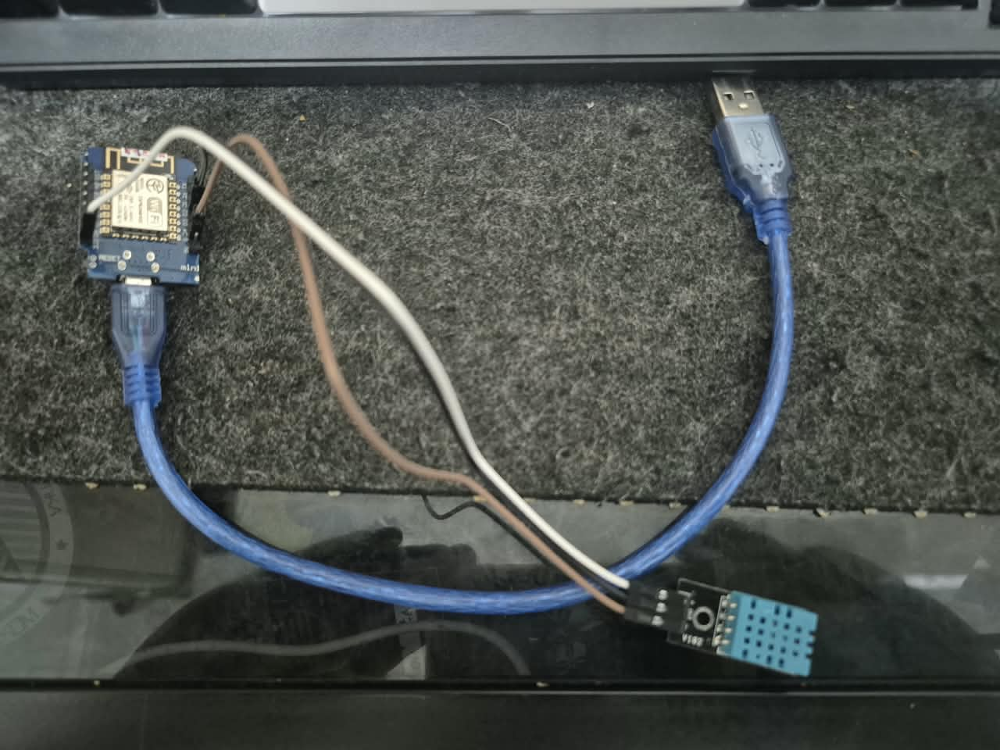

# Sistem Pemantauan Suhu & Kelembaban Ruangan Berbasis IoT 🌡️💧

Proyek *End-to-End* Internet of Things (IoT) untuk memantau suhu dan kelembaban ruangan secara *real-time*. Sistem ini membaca data lingkungan fisik menggunakan sensor DHT11 dan mikrokontroler NodeMCU ESP8266, lalu menampilkannya pada dasbor web lokal serta mencatat riwayat datanya ke dalam *database* MySQL melalui antarmuka API PHP.

## 🚀 Fitur Utama
- **Pemantauan Real-Time:** Dasbor antarmuka web yang diperbarui secara otomatis menggunakan protokol HTTP dari perangkat NodeMCU.
- **Pencatatan Data Otomatis:** Perangkat mengirimkan *payload* suhu dan kelembaban ke *server* secara periodik (setiap 10 detik) menggunakan metode HTTP POST.
- **Sistem Manajemen Basis Data:** Menyimpan riwayat metrik ruangan menggunakan MySQL untuk keperluan pelacakan dan visualisasi data lebih lanjut.
- **Tabel Riwayat Interaktif:** Halaman web PHP untuk melihat 20 rekaman data terbaru lengkap dengan stempel waktu (*timestamp*).

## 🛠️ Teknologi yang Digunakan
* **Perangkat Keras:** NodeMCU V3 (ESP8266), Sensor Suhu & Kelembaban DHT11.
* **Firmware/Bahasa:** C++ (Arduino IDE).
* **Backend:** PHP Murni (Native).
* **Database:** MySQL (Lingkungan Laragon).
* **Frontend:** HTML, CSS, Vanilla JavaScript.

## ⚙️ Cara Menjalankan Proyek (Setup)

### 1. Persiapan Database
1. Nyalakan layanan **Apache** dan **MySQL** pada Laragon.
2. Buat *database* baru bernama `iot_monitoring`.
3. Impor file struktur SQL yang berada di dalam folder `/database`, atau jalankan *query* berikut:
   ```sql
   CREATE TABLE riwayat_sensor (
       id INT AUTO_INCREMENT PRIMARY KEY,
       suhu DECIMAL(5,2) NOT NULL,
       kelembaban DECIMAL(5,2) NOT NULL,
       waktu_rekam TIMESTAMP DEFAULT CURRENT_TIMESTAMP
   );

## 📸 Dokumentasi Visual

**Perangkat Keras NodeMCU & DHT11**
